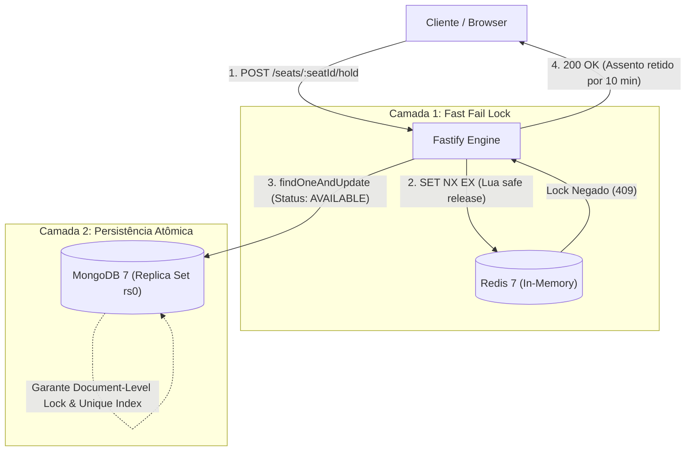

# 🎬 Cinema Seat Reservation Engine (PoC)

> [!NOTE]  
> **Status:** Prova de Conceito (PoC)  
> Este repositório é estritamente uma **Prova de Conceito experimental** desenvolvida para validar estratégias de concorrência em tempo real, consistência atômica e prevenção de *overbooking* utilizando **MongoDB** e **Redis**. Não representa a arquitetura final nem o código de produção definitivo.

---

## 🎯 Objetivo da PoC

Avaliar a eficiência e a robustez de um modelo de concorrência em duas camadas para reservas de assentos de alta demanda:

1. **Camada 1 — Lock Distribuído em Memória (Redis):** Bloqueio temporário ultra-rápido via `SET seat_lock:<sessionId>:<seatId> <cartId> NX EX <ttl>`. Requisições concorrentes perdedoras são rejeitadas em submilissegundos com HTTP `409 Conflict`, sem onerar o banco de dados.
2. **Camada 2 — Persistência e Consistência Atômica (MongoDB):** Assentos modelados como **documentos individuais materializados** na coleção `session_seats`, com índice único composto `{ sessionId: 1, seatNumber: 1 }` e mutações de estado via `findOneAndUpdate` atômico no motor WiredTiger.



---

## 🛠️ Stack Tecnológica

| Tecnologia | Finalidade |
| :--- | :--- |
| **Node.js** (v22+) | Runtime JavaScript moderno com suporte nativo a ESM (`"type": "module"`) |
| **TypeScript** (v5) | Tipagem estática e segurança em tempo de compilação |
| **Fastify** (v5) | Framework HTTP focado em altíssimo throughput e baixa latência |
| **MongoDB** (v7.0) | Banco de dados NoSQL com Replica Set de nó único (`rs0`) |
| **Driver Nativo MongoDB** | Manipulação direta sem overhead de hidratação de ODM |
| **Redis** (v7.0) | Cache e distributed lock em memória |
| **ioredis** | Cliente Redis robusto com suporte a scripts Lua e reconexão |
| **Biome** | Formatação e linter de código ultrarrápidos |
| **Docker & Docker Compose** | Orquestração simplificada dos serviços auxiliares e Redis Insight |

---

## 📂 Estrutura do Projeto

```text
├── docs/
│   ├── PRD.md                                   # Requisitos do produto e regras de negócio
│   └── adr/
│       ├── 001-seat-locking-and-concurrency.md  # ADR: Estratégia de Lock Redis + Mongo
│       └── 002-individual-seat-entities.md      # ADR: Assentos como documentos materializados
├── src/
│   ├── config/
│   │   └── env.ts                               # Validação tipada de variáveis de ambiente com Zod
│   ├── infra/
│   │   ├── db/
│   │   │   ├── models/
│   │   │   │   └── session-seat.ts              # Tipos TypeScript para a entidade SessionSeat
│   │   │   ├── mongo.ts                         # Conexão e singleton do MongoDB nativo
│   │   │   └── seed.ts                          # Script de criação de índice composto e seed
│   │   └── redis/
│   │       └── client.ts                        # Conexão e cliente ioredis
│   ├── app.ts                                   # Instância do Fastify e rotas de infraestrutura
│   └── server.ts                                # Ponto de entrada com graceful shutdown
├── docker-compose.yml                           # MongoDB 7 (rs0), Redis 7 e Redis Insight
├── biome.json                                   # Configuração de linter e formatação
└── tsconfig.json                                # Configuração do TypeScript ESM (NodeNext)
```

---

## 🚀 Como Executar

### Pré-requisitos
- [Node.js](https://nodejs.org/) `>= 22.0.0`
- [pnpm](https://pnpm.io/) `>= 9.0.0`
- [Docker](https://www.docker.com/) e Docker Compose

---

### Passo 1: Clonar o Repositório e Instalar Dependências

```bash
git clone <url-do-repositorio>
cd asaas-poc
pnpm install
```

---

### Passo 2: Configurar as Variáveis de Ambiente

Copie o arquivo de exemplo `.env.example` para `.env`:

```bash
cp .env.example .env
```

Configurações padrão presentes no `.env`:
```env
PORT=3001
HOST=0.0.0.0
NODE_ENV=development

MONGO_URI=mongodb://localhost:27017/cinema?replicaSet=rs0&directConnection=true
MONGO_DB_NAME=cinema

REDIS_HOST=localhost
REDIS_PORT=6379
```

---

### Passo 3: Subir os Containers Docker (Ambiente Completo com Node 26)

Inicie os contêineres do MongoDB (com replica set `rs0`), Redis, Redis Insight e a API Node 26 com hot-reload automático:

```bash
docker compose up -d
```

Verifique se todos os serviços estão saudáveis:
```bash
docker compose ps
```

> [!TIP]
> **Hot-Reload em Tempo Real:** O serviço `api` está executando em **Node.js 26 (Alpine)** com `tsx watch` e sincronização de volumes. Ao alterar e salvar qualquer arquivo em `src/` na sua máquina hospedeira, o servidor reinicia automaticamente e aplica a mudança em milissegundos sem necessidade de reiniciar o container Docker manualmente!
>
> Para acompanhar os logs de hot-reload em tempo real:
> ```bash
> docker compose logs -f api
> ```

---

### Passo 4: Executar o Seed do Banco de Dados

O script cria o índice composto `{ sessionId: 1, seatNumber: 1 }` com `{ unique: true }` na collection `session_seats` e insere 20 assentos de teste (`A1` a `A20`) para a sessão `sessao-cinema-101`.

Você pode executar diretamente via container Docker:
```bash
docker compose exec api pnpm db:seed
```
*(Ou localmente no host com `pnpm db:seed`)*

Saída esperada:
```text
🌱 Starting database seed...
Creating compound unique index { sessionId: 1, seatNumber: 1 }...
✅ Index created or verified: session_seat_unique_idx
Populating session "sessao-cinema-101" with 20 seats (A1 to A20)...
✅ Inserted 20 seats for session "sessao-cinema-101".
🌱 Seed completed successfully!
```

---

### Passo 5: Testar e Desenvolver

O servidor já está ativo dentro do container ouvindo na porta mapeada `http://localhost:3001`.

Para testar a saúde da aplicação:
```bash
curl http://localhost:3001/health
```
pnpm dev
```

O servidor estará ouvindo em: `http://localhost:3001`.

---

## 🔍 Testando o Ambiente

### Healthcheck da Aplicação
Com o servidor rodando, consulte o status dos serviços conectados:

```bash
curl http://localhost:3001/health
```

Resposta esperada (HTTP 200):
```json
{
  "status": "healthy",
  "timestamp": "2026-11-05T13:34:09.375Z",
  "services": {
    "mongo": "up",
    "redis": "up"
  }
}
```

### Visualização de Dados (Redis Insight)
Acesse a interface visual do Redis Insight no navegador:
👉 [http://localhost:5540](http://localhost:5540)

- Adicione uma nova conexão apontando para o Host `redis` (porta `6379`) dentro da rede Docker, ou `localhost:6379` diretamente do host.

---

## 🛠️ Comandos de Desenvolvimento

| Comando | Descrição |
| :--- | :--- |
| `pnpm dev` | Inicia o servidor Fastify com recarregamento a quente via `tsx watch` |
| `pnpm build` | Compila o TypeScript para a pasta `dist/` |
| `pnpm start` | Executa o código compilado em produção |
| `pnpm db:seed` | Executa o seed de assentos e índice no MongoDB |
| `pnpm lint` | Executa a validação de linter com Biome |
| `pnpm format` | Formata o código-fonte seguindo o padrão Biome |

---

## 📋 Endpoints Planejados na PoC

Conforme especificado no [docs/PRD.md](file:///Users/rparana/dev/private/asaas-poc/docs/PRD.md):

- `GET /health` — Status dos serviços integrados (Implementado)
- `GET /api/v1/sessions/:sessionId/seats` — Lista assentos e estados (`AVAILABLE`, `HELD`, `RESERVED`)
- `POST /api/v1/sessions/:sessionId/seats/:seatId/hold` — Bloqueio temporário (10 min) com `cartId`
- `POST /api/v1/sessions/:sessionId/seats/:seatId/confirm` — Confirmação de compra
- `DELETE /api/v1/sessions/:sessionId/seats/:seatId/hold` — Liberação manual de assento

