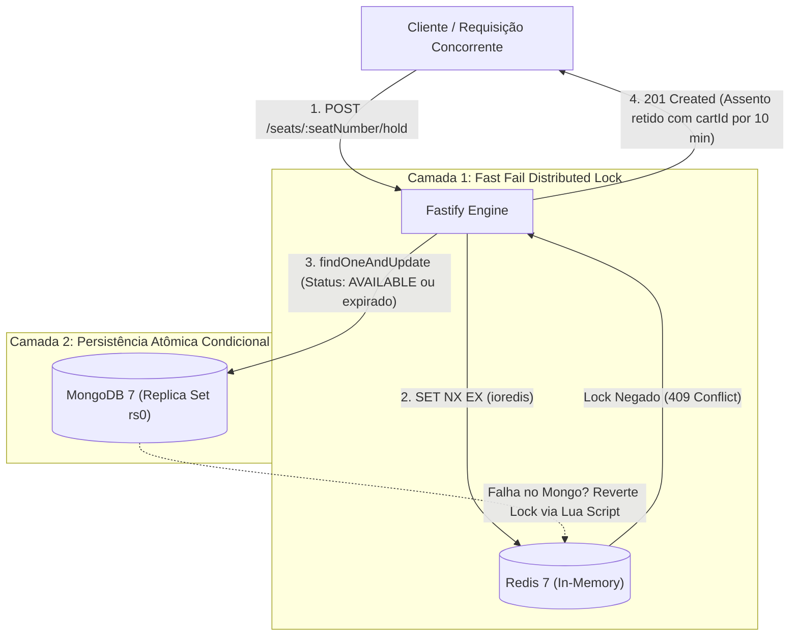

# 🎬 Cinema Seat Reservation Engine (PoC)

> [!NOTE]  
> **Status:** Prova de Conceito (PoC)  
> Este repositório é estritamente uma **Prova de Conceito experimental** desenvolvida para validar estratégias de concorrência em tempo real, consistência atômica e prevenção de *overbooking* utilizando **MongoDB** e **Redis**. Não representa a arquitetura final nem o código de produção definitivo.

> [!IMPORTANT]  
> **Nota sobre Arquitetura e Escopo de PoC:**  
> Por se tratar de uma Prova de Conceito com o objetivo único de validar a concorrência atômica, baixa latência e resiliência de locks distribuídos, o design de código priorizou objetividade, clareza e baixo atrito de prototipação. Por essa razão, **não** foram introduzidas camadas formais de abstração como separação rígida de Repositórios genéricos, Interfaces desacopladas, nem arquiteturas complexas como **Clean Architecture completa**, **Arquitetura Hexagonal (Ports & Adapters)** ou **DDD Tático formal**.  
> Em um projeto corporativo definitivo para produção em larga escala, tais arquiteturas seriam a escolha natural para garantir total independência de frameworks, inversão de controle formal e facilidade de substituição ou mock de infraestrutura.

---

## 🎯 Objetivo da PoC

Avaliar a eficiência e a robustez de um modelo de concorrência em duas camadas para reservas de assentos de alta demanda:

1. **Camada 1 — Lock Distribuído em Memória (Redis):** Bloqueio temporário ultra-rápido via `SET seat_lock:<sessionId>:<seatNumber> <cartId> NX EX <ttlSeconds>`. Requisições concorrentes perdedoras são rejeitadas em submilissegundos com HTTP `409 Conflict`, sem onerar o banco de dados.
2. **Camada 2 — Persistência e Consistência Atômica (MongoDB):** Assentos modelados como **documentos individuais materializados** na coleção `session_seats`, com índice único composto `{ sessionId: 1, seatNumber: 1 }` e mutações de estado via `findOneAndUpdate` atômico no motor WiredTiger.
3. **Mecanismo de Compensação (Rollback Automático):** Caso o lock no Redis seja adquirido com sucesso, mas o assento no MongoDB já não esteja mais disponível (`AVAILABLE` ou `HELD` expirado), o lock é imediatamente desfeito via script Lua e HTTP 409 é retornado.



---

## 🛠️ Stack Tecnológica

| Tecnologia | Finalidade |
| :--- | :--- |
| **Node.js 26** (Alpine) | Runtime JavaScript de última geração com suporte a ESM nativo |
| **TypeScript** (v5) | Tipagem estática e segurança em tempo de compilação |
| **Fastify** (v5) | Framework HTTP focado em altíssimo throughput e baixa latência |
| **Vitest** (v5) | Framework moderno e ultrarrápido para testes automatizados de concorrência |
| **Zod** (v3) | Validação estrita de parâmetros de rota, payloads e variáveis de ambiente |
| **MongoDB** (v7.0) | Banco de dados NoSQL com Replica Set de nó único (`rs0`) e transações |
| **Driver Nativo MongoDB** | Manipulação direta sem overhead de hidratação de ODM |
| **Redis** (v7.0) | Cache e distributed lock em memória com execução atômica via Lua Scripts |
| **ioredis** | Cliente Redis performático com pool de conexões e reconexão automática |
| **Vue 3 + Vite** | SPA reativa simulando o totem de autoatendimento do cinema |
| **Tailwind CSS v4** | Estilização moderna com `@tailwindcss/vite` e microinterações visuais |
| **Server-Sent Events (SSE)** | Streaming unidirecional em tempo real acoplado a Redis Pub/Sub |
| **Biome** | Formatação e linter de código ultrarrápidos |
| **Docker & Docker Compose** | Orquestração completa dos contêineres com **Hot-Reload em tempo real** |

---

## 📂 Estrutura do Projeto

```text
├── docs/
│   ├── PRD.md                                   # Requisitos do produto e regras de negócio
│   └── adr/
│       ├── 001-seat-locking-and-concurrency.md  # ADR: Estratégia de Lock Redis + Mongo
│       ├── 002-individual-seat-entities.md      # ADR: Assentos como documentos materializados
│       └── 003-realtime-updates-via-sse.md      # ADR: Streaming SSE com Redis Pub/Sub
├── frontend/                                    # SPA em Vue 3 + Vite + Tailwind CSS v4
│   ├── src/
│   │   ├── components/
│   │   │   ├── SeatMap.vue                      # Grade interativa de assentos, SSE e timers
│   │   │   └── ToastNotification.vue            # Alertas flutuantes de conflito (409) e sucesso
│   │   ├── App.vue                              # Layout principal e switcher de totem
│   │   └── style.css                            # Estilização com Tailwind v4
│   ├── index.html                               # HTML montador da SPA
│   └── vite.config.ts                           # Proxy reverso (/api -> backend:3001)
├── src/
│   ├── application/
│   │   └── use-cases/
│   │       ├── hold-seat.use-case.ts            # Bloqueio temporário (Hold) em 2 camadas
│   │       ├── confirm-seat.use-case.ts         # Confirmação atômica de compra (Reserved)
│   │       ├── release-seat.use-case.ts         # Liberação manual antecipada
│   │       └── list-seats.use-case.ts           # Listagem do mapa da sessão e status efetivo
│   ├── domain/
│   │   └── errors/
│   │       └── seat-errors.ts                   # Erros de domínio mapeados para códigos HTTP
│   ├── http/
│   │   └── routes/
│   │       └── seat-routes.ts                   # Rotas Fastify validadas com esquemas Zod
│   ├── config/
│   │   └── env.ts                               # Variáveis de ambiente tipadas com Zod
│   ├── infra/
│   │   ├── db/
│   │   │   ├── models/
│   │   │   │   └── session-seat.ts              # Modelagem da entidade SessionSeat
│   │   │   ├── mongo.ts                         # Conexão e singleton do MongoDB nativo
│   │   │   └── seed.ts                          # Criação de índice único composto e 20 assentos
│   │   └── redis/
│   │       ├── client.ts                        # Conexão e cliente ioredis
│   │       └── redis-lock-service.ts            # Lock distribuído (SET NX EX e release via Lua)
│   ├── test/
│   │   └── concurrency.test.ts                  # Teste automatizado de concorrência com Vitest
│   ├── app.ts                                   # Setup do Fastify, rotas e tratamento global de erros
│   └── server.ts                                # Entrada da aplicação com graceful shutdown
├── Dockerfile                                   # Imagem Node 26 Alpine para desenvolvimento
├── docker-compose.yml                           # MongoDB 7, Redis 7, Redis Insight e API (Node 26)
├── biome.json                                   # Configuração do Biome
├── tsconfig.json                                # Configuração do TypeScript ESM (NodeNext)
└── vitest.config.ts                             # Configuração do Vitest
```

---

## 🚀 Como Executar

### Pré-requisitos
- [Docker](https://www.docker.com/) e Docker Compose instalados
- Opcional para rodar fora do Docker: [Node.js](https://nodejs.org/) `>= 22` e [pnpm](https://pnpm.io/) `>= 11`

---

### Passo 1: Configurar Variáveis de Ambiente

Copie o arquivo de exemplo `.env.example` para `.env`:

```bash
cp .env.example .env
```

---

### Passo 2: Subir os Containers Docker (Ambiente Completo com Node 26)

Inicie todos os contêineres:

```bash
docker compose up -d
```

Verifique se todos os serviços estão saudáveis:
```bash
docker compose ps
```

> [!TIP]
> **Hot-Reload em Tempo Real:** O serviço `api` roda dentro do container com `tsx watch` e sincronização de volumes. Ao alterar e salvar qualquer arquivo em `src/` no seu editor, o serviço reinicia e aplica as mudanças automaticamente!
> Para acompanhar os logs:
> ```bash
> docker compose logs -f api
> ```

---

### Passo 3: Executar o Seed Inicial

Cria o índice único composto `{ sessionId: 1, seatNumber: 1 }` (`unique: true`) na collection `session_seats` e popula a sessão `sessao-cinema-101` com 20 assentos (`A1` a `A20`):

```bash
docker compose exec api pnpm db:seed
```

---

### Passo 4: Iniciar a Interface Web Reativa (Totem SPA)

Inicie o servidor de desenvolvimento do frontend:

```bash
pnpm frontend:dev
```

Acesse o totem interativo no navegador:
👉 **[http://localhost:5173](http://localhost:5173)**

> [!TIP]
> **Como Demonstrar a Concorrência Visualmente:**
> 1. Abra duas janelas do navegador lado a lado em [http://localhost:5173](http://localhost:5173).
> 2. Clique em **"Abrir Outra Aba"** ou no botão **"🔄 Trocar"** em uma das abas para que cada janela represente um **totem/carrinho diferente**.
> 3. Na Aba 1, clique em um assento verde (`AVAILABLE`):
>    - Na **Aba 1**, o assento fica **amarelo** com borda pulsante, timer regressivo e botões de "Confirmar Compra" e "Liberar".
>    - Instantaneamente na **Aba 2** (via SSE + Redis Pub/Sub), o assento muda para **laranja com cadeado** indicando *"Em seleção por outro usuário"*.
> 4. Se a Aba 2 tentar clicar no assento enquanto ele está bloqueado, receberá um **alerta/toast flutuante (HTTP 409)**: *"Cadeira indisponível! Outro usuário acabou de selecioná-la."*
> 5. Ao confirmar a compra na Aba 1, o assento vira **vermelho ("Vendido")** em tempo real em todas as telas conectadas.

---

## 🧪 Testes Automatizados de Concorrência (Vitest)

O projeto possui uma suite de testes automatizados em [src/test/concurrency.test.ts](file://./src/test/concurrency.test.ts) que valida matematicamente a prevenção de *overbooking*:

1. **Disputa de 10 Requisições Simultâneas (`Promise.all`):**
   - 10 requisições simultâneas disputam o mesmo assento (`A10`) com `cartIds` distintos.
   - Valida que **exatamente 1 requisição obtém HTTP 201** e **as outras 9 recebem HTTP 409 Conflict**.
   - Confirma no MongoDB que o assento está `HELD` pelo `cartId` vencedor.
   - Confirma no Redis que apenas 1 lock existe com TTL ativo.
2. **Liberação Manual via DELETE:**
   - Valida cancelamento voluntário do carrinho anterior seguido por aquisição imediata com sucesso por um novo carrinho.
3. **Expiração Real de TTL:**
   - Valida que após o término do TTL (tempo de hold expirado), uma nova requisição retoma o assento com sucesso.

### Executando os Testes

Via container Docker:
```bash
docker compose exec api pnpm test
```

Ou no host local:
```bash
pnpm test
```

---

## 📡 Guia de Uso da API (Endpoints REST)

A API roda por padrão na porta **3001** (`http://localhost:3001`).

### 1. Mapa da Sessão (Listar Assentos)
Retorna o mapa de assentos da sessão com contadores agregados e status efetivo:
- Se um assento estiver `HELD` e o tempo de expiração tiver vencido, o status retornado é automaticamente calculado como `AVAILABLE` (RF05).

```bash
curl -s http://localhost:3001/api/v1/sessions/sessao-cinema-101/seats
```

**Exemplo de Resposta (HTTP 200):**
```json
{
  "sessionId": "sessao-cinema-101",
  "totalSeats": 20,
  "availableCount": 20,
  "heldCount": 0,
  "reservedCount": 0,
  "seats": [
    { "seatNumber": "A1", "status": "AVAILABLE", "expiresAt": null },
    { "seatNumber": "A2", "status": "AVAILABLE", "expiresAt": null }
  ]
}
```

---

### 2. Bloqueio Temporário (Hold Seat)
Retém temporariamente uma poltrona vinculada ao `cartId` por 10 minutos (TTL padrão configurável via `.env` ou parâmetro `ttlSeconds` opcional).

```bash
curl -s -i -X POST http://localhost:3001/api/v1/sessions/sessao-cinema-101/seats/A1/hold \
  -H "Content-Type: application/json" \
  -d '{"cartId": "cart-uuid-101"}'
```

**Resposta de Sucesso (HTTP 201 Created):**
```json
{
  "message": "Assento A1 bloqueado temporariamente com sucesso.",
  "seat": {
    "sessionId": "sessao-cinema-101",
    "seatNumber": "A1",
    "status": "HELD",
    "cartId": "cart-uuid-101",
    "expiresAt": "2026-11-05T14:36:21.151Z"
  }
}
```

**Tentativa Concorrente Duplicada (HTTP 409 Conflict):**
```json
{
  "statusCode": 409,
  "error": "SEAT_ALREADY_TAKEN",
  "message": "Assento A1 já está temporariamente retido ou ocupado por outro usuário."
}
```

---

### 3. Confirmação da Reserva (Confirm Seat)
Efetiva a compra do ingresso, convertendo o status de `HELD` para `RESERVED` e removendo com segurança o lock do Redis.

```bash
curl -s -i -X POST http://localhost:3001/api/v1/sessions/sessao-cinema-101/seats/A1/confirm \
  -H "Content-Type: application/json" \
  -d '{"cartId": "cart-uuid-101"}'
```

**Resposta de Sucesso (HTTP 200):**
```json
{
  "message": "Assento A1 confirmado e reservado com sucesso.",
  "seat": {
    "sessionId": "sessao-cinema-101",
    "seatNumber": "A1",
    "status": "RESERVED",
    "cartId": "cart-uuid-101",
    "updatedAt": "2026-11-05T14:17:30.872Z"
  }
}
```

---

### 4. Liberação Manual (Cancelamento / Release)
Permite que o usuário desista da escolha antes dos 10 minutos, liberando o assento imediatamente para `AVAILABLE` tanto no MongoDB quanto no Redis.

```bash
curl -s -i -X DELETE http://localhost:3001/api/v1/sessions/sessao-cinema-101/seats/A2/hold \
  -H "Content-Type: application/json" \
  -d '{"cartId": "cart-uuid-101"}'
```

---

### 5. Streaming em Tempo Real (Server-Sent Events)
Conexão persistente SSE para transmissão reativa unidirecional de eventos disparados pelo Redis Pub/Sub:

```bash
curl -N http://localhost:3001/api/v1/sessions/sessao-cinema-101/stream
```

Eventos emitidos:
- `SEAT_HELD`: `{ "event": "SEAT_HELD", "seatNumber": "A1", "cartId": "...", "expiresAt": "..." }`
- `SEAT_RESERVED`: `{ "event": "SEAT_RESERVED", "seatNumber": "A1" }`
- `SEAT_RELEASED`: `{ "event": "SEAT_RELEASED", "seatNumber": "A1" }`

---

### 6. Checagem de Saúde (Healthcheck)
```bash
curl -s http://localhost:3001/health
```

**Resposta (HTTP 200):**
```json
{
  "status": "healthy",
  "version": "1.0.0-poc",
  "timestamp": "2026-11-05T14:18:00.000Z",
  "services": {
    "mongo": "up",
    "redis": "up"
  }
}
```

---

## 🖥️ Inspeção Visual com Redis Insight

Abra no navegador:
👉 [http://localhost:5540](http://localhost:5540)

- Adicione uma nova conexão apontando para o Host `redis` na porta `6379`.
- Você poderá visualizar as chaves ativas no formato `seat_lock:<sessionId>:<seatNumber>` e acompanhar a contagem regressiva do TTL em tempo real.

---

## 🛠️ Comandos de Desenvolvimento

| Comando | Descrição |
| :--- | :--- |
| `docker compose up -d` | Sobe o ambiente completo (DBs + API em Node 26) |
| `pnpm frontend:dev` | Inicia o Totem SPA em Vue 3 + Tailwind v4 em `http://localhost:5173` |
| `docker compose exec api pnpm db:seed` | Executa o seed de assentos no MongoDB via Docker |
| `docker compose exec api pnpm test` | Executa os testes automatizados de concorrência com Vitest |
| `docker compose logs -f api` | Acompanha os logs e hot-reload da aplicação |
| `pnpm test` | Executa a suite de testes no host |
| `pnpm lint` | Executa a validação de linter com Biome |
| `pnpm format` | Formata o código-fonte seguindo o padrão Biome |
